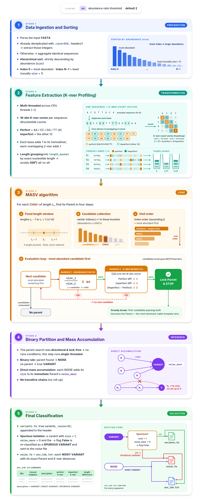
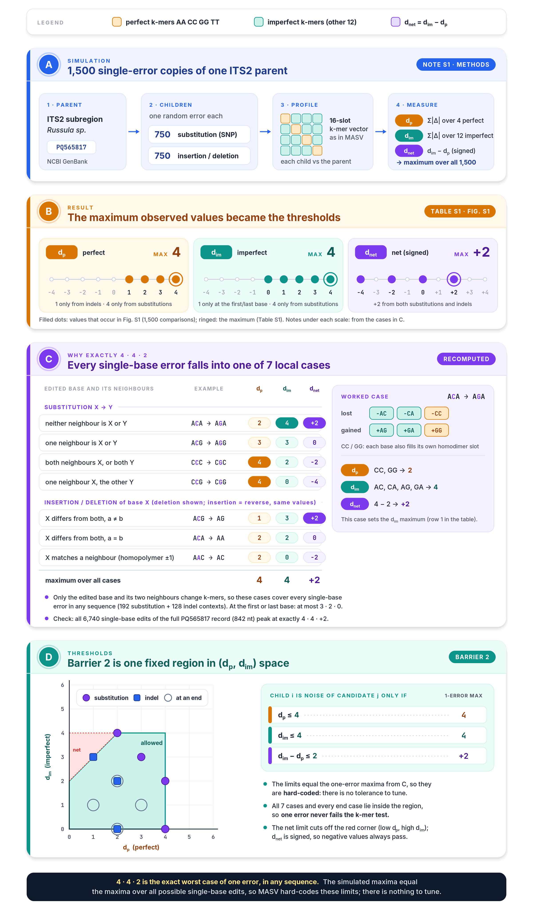
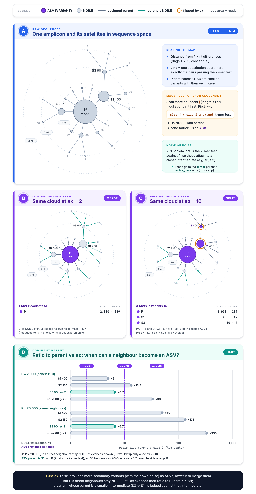

# MASV

**Alignment-free denoising of fungal ITS amplicon sequence variants**  
Separate amplicon variants from sequencing noise using k-mer profiles and abundance ratios.


[Quick start](#quick-start) · [Demo](#demo) · [How it works](#how-it-works) · [K-mer thresholds](#k-mer-thresholds) · [Choosing ax](#choosing-ax) · [Parameters](#parameters) · [Outputs](#output-files) · [Citation](#citation)

---


## Why MASV

MASV suits high-resolution work, such as deep sequencing of individual fungi from cultures or herbarium specimens, where you want to keep as much intraspecific ITS variation as possible.

- **Transparent.** Every unique sequence gets a row in `asv_tab.txt` showing its label, its parent (if any), and the k-mer metrics behind the decision.

- **Lightweight.** MASV 2.0.0 is a single C++17 source file. Build it with `g++`; there are no libraries to install.

- **Alignment-free.** MASV compares sequences by their k-mer profiles instead of aligning them, which preserves length variation among amplicons and keeps it fast and simple.

- **Adjustable.** It was built for Illumina ITS data, but nothing in the method is specific to ITS, so it works on amplicon HTS data from any marker or organism.

- **Focused on sequencing errors.** MASV removes only machine-generated noise and leaves pre-sequencing artifacts (e.g., PCR errors and chimeras), together with real variants, for you to evaluate downstream.


## Quick start

Build [`masv.cpp`](masv.cpp) and run it on a FASTA file of reads:

```bash
g++ -O3 -std=c++17 -pthread masv.cpp -o masv
./masv -i input.fasta -t 4
```

MASV dereplicates the file and sorts the unique sequences by abundance. Each FASTA record counts as one read, unless its header already contains `size=`, in which case that count is used. Identical sequences are merged, and the first header is kept. Sequences may contain only `A`, `C`, `G`, and `T` (any case). An ambiguous base stops the run with an error. The three result files are written to the current directory.

Example with the defaults written out:

```bash
./masv -i input.fasta -a 2 -s False -t 2
```


## Demo

The demo files are in [`demo/`](https://github.com/vassishap/masv/tree/main/demo). Build `masv`, put that binary and `usearch` on your `PATH`, then:

```bash
g++ -O3 -std=c++17 -pthread masv.cpp -o masv
cd demo && bash MASV_demo.bash
```

The script denoises the ITS and 16S unique reads at ax 2 and at the higher benchmark values (6 for ITS, 6.3 for 16S). Each of those runs is followed by a `usearch -uchime3_denovo` chimera check. `ITS_refs.fa` and `16S_refs.fa` are for the optional reference comparison, which is left commented out in the script.

## How it works

  
The default ax is 2.

1. **Ingest and sort.** MASV dereplicates the reads and sorts the unique sequences from most to least abundant.
2. **Profile.** Each sequence becomes a 16-slot dinucleotide count. Every base also increments its own homodimer (`AA`, `CC`, `GG`, `TT`), which is the same as doubling each base and then counting dimers.
3. **Compare.** Each sequence looks for a parent among earlier sequences in that list (equally or more abundant) whose length is within ±1 nt. Candidates are tried from most abundant to least, and the first one that passes both barriers is the parent. The search is parallel (`-t` threads).
    - **Abundance:** `size_parent / size_child ≥ ax`
    - **K-mer:** perfect-dimer difference ≤ 4, imperfect-dimer difference ≤ 4, and (imperfect − perfect) ≤ 2
4. **Accumulate.** A sequence that found a parent is noise, and its abundance is added to that parent's noise mass. This sum runs one sequence at a time after the parallel search finishes.
5. **Label.** A sequence with a parent is a `NOISY VARIANT`. A sequence with no parent is a `VARIANT`. A single read with no parent and noise mass 0 is a `SPURIOUS VARIANT` (with `-s True` it stays a `VARIANT`).


## K-mer thresholds



The k-mer limits are fixed at 4, 4, and 2. A candidate passes only when the perfect-dimer difference is at most 4, the imperfect-dimer difference is at most 4, and (imperfect − perfect) is at most 2. Those values are the exact worst case of a single nucleotide error, measured on 750 random SNPs and 750 random indels of one *Russula* sp. ITS2 parent. They are not a command-line setting.

> [!IMPORTANT]
> Long-read technologies (e.g. PacBio, Oxford Nanopore) have very different error profiles and rates. These limits were set on Illumina single-error noise. Using MASV directly on data from these or other non-Illumina platforms will likely give suboptimal results. Re-evaluate the abundance ratio first.


## Choosing ax

  
The default ax is 2.

`ax` (`-a`) is the setting with the most influence on the result. **Raising ax** keeps more secondary variants as ASVs, along with their own noise. **Lowering ax** merges them into their dominant parent. Even so, when a parent is very abundant, its close neighbors stay noise until `ax` is larger than their abundance ratio to that parent. That's why it pays to try a few values on your own data.

The default is **2**.

## Parameters


| Flag | Meaning                                                                                                                                                                                                                                                 | Default |
| ---- | ------------------------------------------------------------------------------------------------------------------------------------------------------------------------------------------------------------------------------------------------------- | ------- |
| `-i` | Input FASTA file (**required**)                                                                                                                                                                                                                         | –       |
| `-a` | Abundance ratio (`ax`), the minimum *parent size / child size* needed to call a sequence noise                                                                                                                                                          | `2`     |
| `-s` | `True` or `False`. `True` keeps a single-read sequence that has no parent and no noise mass in `variants.fa`, labeled `VARIANT`. Any other value leaves it in `noise.fa`, labeled `SPURIOUS VARIANT`. Only the exact string `True` changes the default. | `False` |
| `-t` | Worker threads for k-mer counting and the parent search                                                                                                                                                                                                 | `2`     |


These are the only flags the program reads.

## Output files

MASV writes three files in the current directory. Sequence titles keep the first FASTA header. When that header has no `size=` field, MASV appends `;size=N;`, where `N` is the merged abundance. A header that already contains `size=` is kept as written, including when later copies of the same sequence add to its abundance.


| File          | Contents                                                                                                                                                                                                                                                                                                                                                                                                                                                                                                                               |
| ------------- | -------------------------------------------------------------------------------------------------------------------------------------------------------------------------------------------------------------------------------------------------------------------------------------------------------------------------------------------------------------------------------------------------------------------------------------------------------------------------------------------------------------------------------------- |
| `variants.fa` | Sequences labeled `VARIANT`. Each header is the sequence title with `noise=N;` appended. `N` is the total abundance of the `NOISY VARIANT` sequences that took this sequence as their direct parent. With `-s True`, parentless single-read sequences that accumulated no noise are written here too, with `noise=0;`.                                                                                                                                                                                                                 |
| `noise.fa`    | Sequences labeled `NOISY VARIANT`, plus `SPURIOUS VARIANT` singletons when `-s` is not `True` (the default). Each header is the sequence title alone.                                                                                                                                                                                                                                                                                                                                                                                  |
| `asv_tab.txt` | Tab-separated report, one row per unique sequence, in abundance order. The header row is `title`, `closest neighbor(s)`, `description`, `perfect k-mer`, `imperfect k-mer`, `length difference`. `description` is `VARIANT`, `NOISY VARIANT`, or `SPURIOUS VARIANT`. For a `NOISY VARIANT`, the neighbor column is its parent title and the last three columns are the perfect-dimer difference, the imperfect-dimer difference, and the absolute length difference. For a `VARIANT` or `SPURIOUS VARIANT`, those four fields are `*`. |


## Citation

If you use MASV in your research, please cite:

> Vasilii Shapkin, Miroslav Kolařík, Petr Kohout, Tomáš Větrovský. *MASV: Alignment-free denoising of fungal ITS amplicon sequence variants.* Manuscript in preparation.


## License

MASV is released under the [GNU General Public License v3.0](LICENSE).